# 🚆 RailConnect — Railway Ticket Booking & Reservation System

A colorful, responsive, full-stack **portfolio demonstration** of a railway booking platform. Built with Python, Flask, SQLite, vanilla JavaScript, and ReportLab.

> **Important:** This is an independent educational demo. Train names, schedules, availability, fares and payments are simulated. It is not affiliated with Bangladesh Railway or any actual ticketing provider. No real tickets or payments are issued.

## ✨ Features
- 🌈 Animated, responsive landing page with colorful gradients and emoji train art (no external GIF assets required)
- 🔎 Route search by origin, destination and travel date
- 💺 Interactive coach seat map with database-enforced protection against duplicate seat reservations
- 🔐 Secure hashed-password accounts, login sessions, CSRF checks and admin authorization
- 💳 Clearly labeled simulated checkout; never collects payment credentials
- 🎟️ Downloadable PDF ticket with QR verification link
- 📲 Public ticket verification page with demo disclaimer
- 📋 Passenger booking history and pending reservation release
- 🛠️ Admin portal for adding, pausing and reactivating trains, and viewing bookings and demo revenue
- 🧪 Automated tests and seeded sample trains

## 🪟 Run on Windows (Python 3.10)
1. Install Python 3.10 from python.org and enable the Python launcher.
2. Extract this ZIP and double-click **run_windows.bat**. First launch requires internet to install packages.
3. Visit **http://127.0.0.1:5000**.
4. Create a passenger account, search for trains, choose a seat, confirm simulated payment, download the PDF and scan its QR.

### Manual startup
```powershell
py -3.10 -m venv .venv
.venv\Scripts\activate
pip install -r requirements.txt
python app.py
```

## 🛠️ Demo administrator
- Email: `admin@railconnect.local`
- Password: `ChangeMe123!` (development demo only)

**Change the password before sharing a running instance.** To customize on first initialization, set the `RAILCONNECT_ADMIN_PASSWORD` environment variable. The app initializes the admin only on a new database. Never deploy with the default demo password.

## 🧪 Tests
```powershell
python -m pytest -q
```

## 📁 Project layout
```
app.py              Flask application, database, routes, ticket generation
static/style.css    Responsive colorful UI and animation
static/app.js       Seat-selection interaction
templates/          Jinja templates for passenger/admin workflows
tests/              Automated Flask tests
run_windows.bat     Windows launcher
requirements.txt    Dependencies
```

## 🔐 Security / production notes
This is a **local demo**, not a production-grade ticketing service. Uses SQLite transactions and uniqueness constraints to prevent duplicate seat assignments. Includes CSRF tokens, hashed passwords and role checks. For public deployment, use HTTPS, persistent strong secret keys, secure session cookies, production WSGI server, rate limiting, account recovery, payment integration, database migrations and monitoring. Pending seats are held until manually released; production needs reservation expiration and refunds. QR verification exposes limited ticket information publicly by design.

## 📸 Screenshots

Real screenshots captured while running the application locally. Sample journeys, reservations, and payments are demonstrations only.

### Homepage

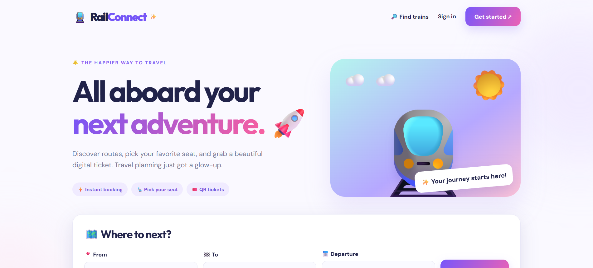

### Popular journeys

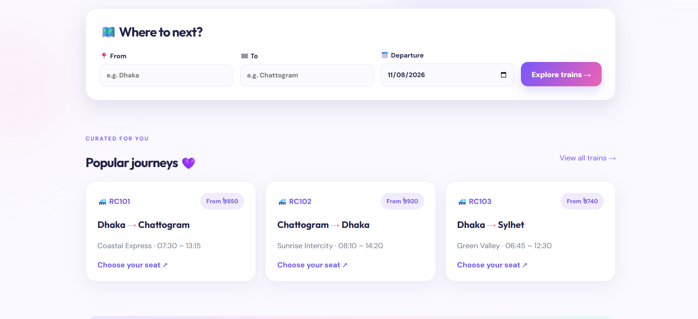

### Passenger registration

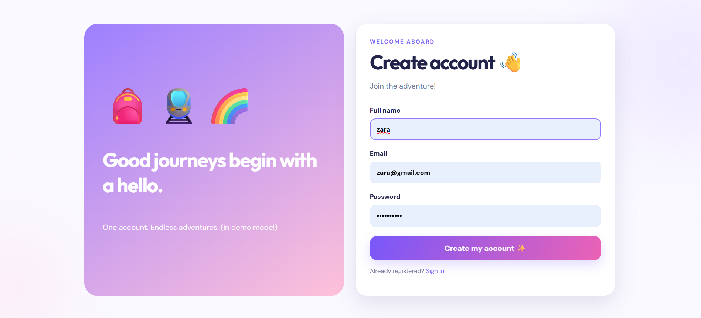

### Route search

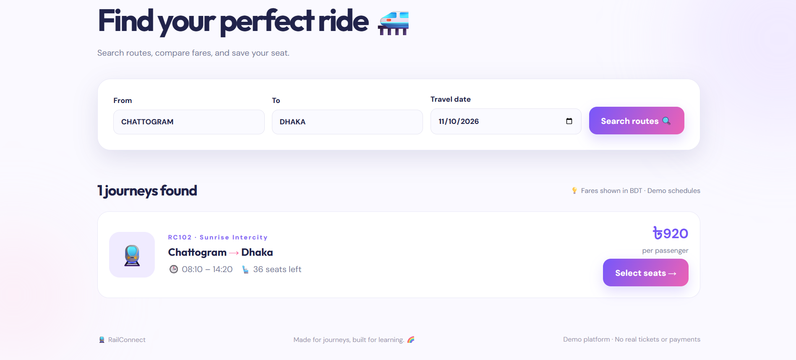

### Seat selection

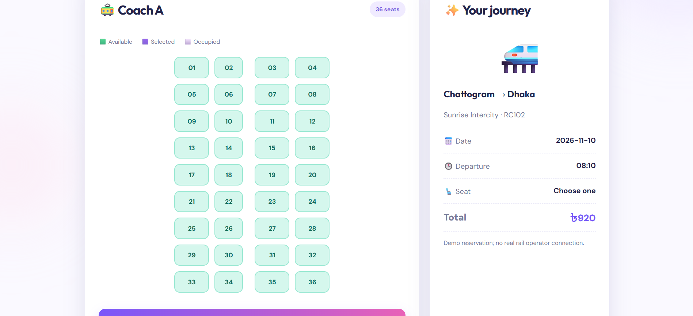

### Simulated checkout

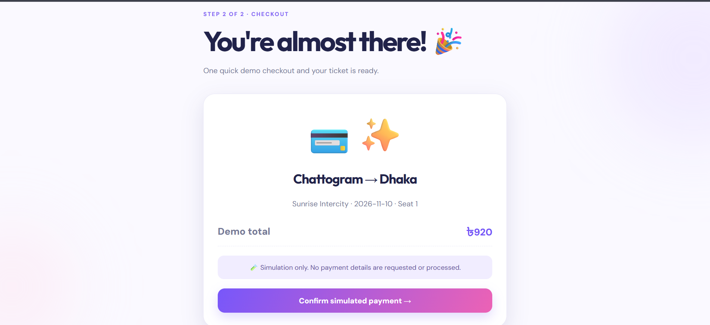

### Ticket confirmation

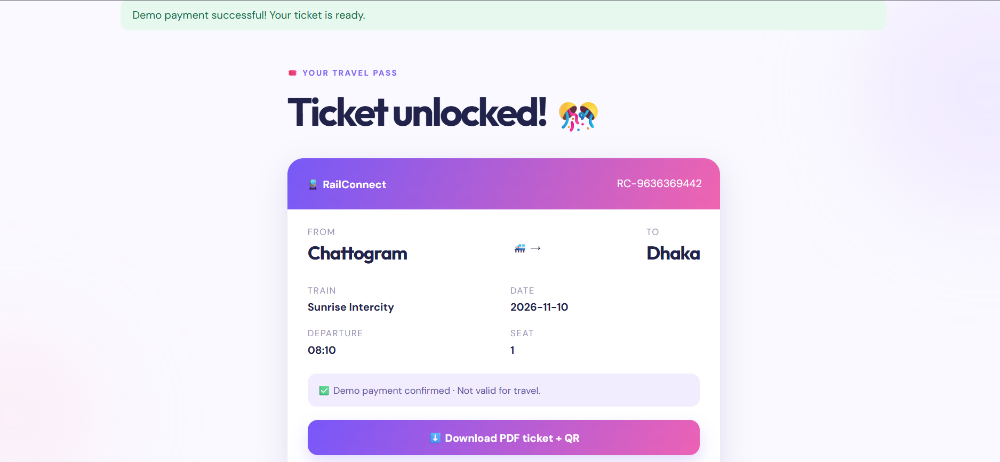

### PDF ticket with QR

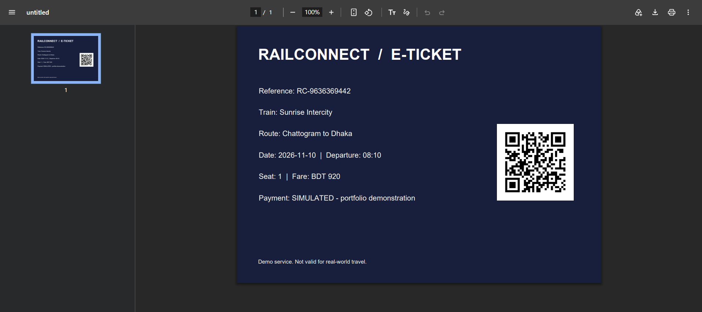

### All trains

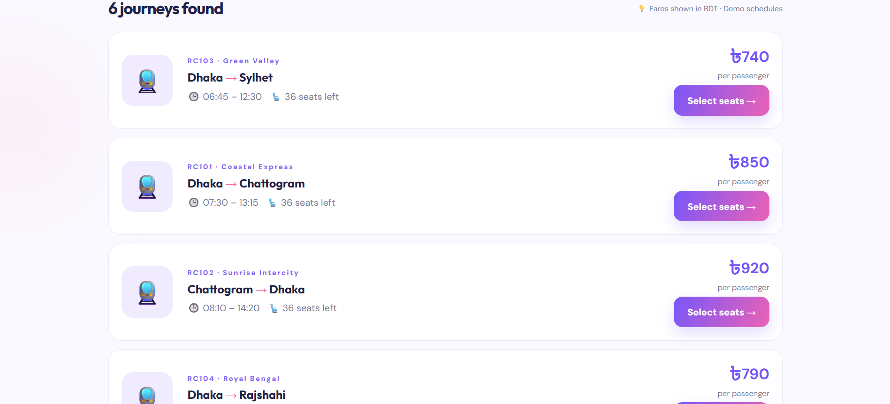

### Admin dashboard

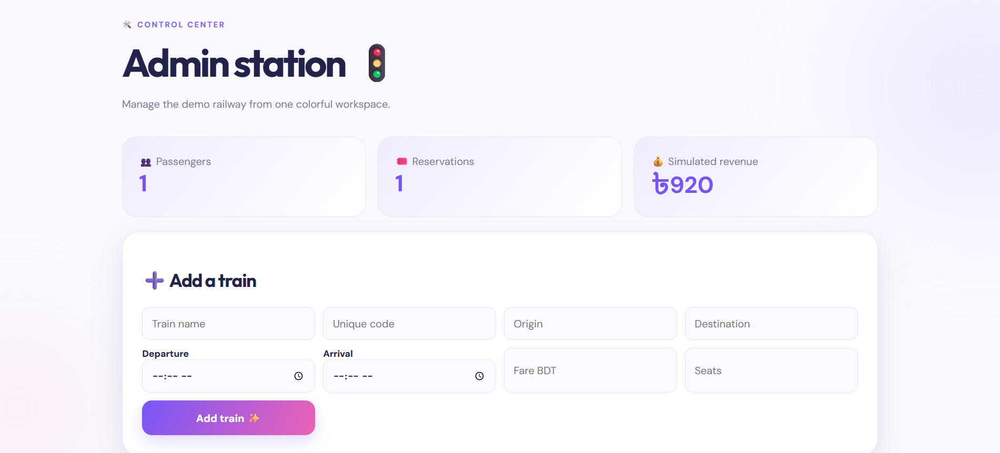

### Fleet management

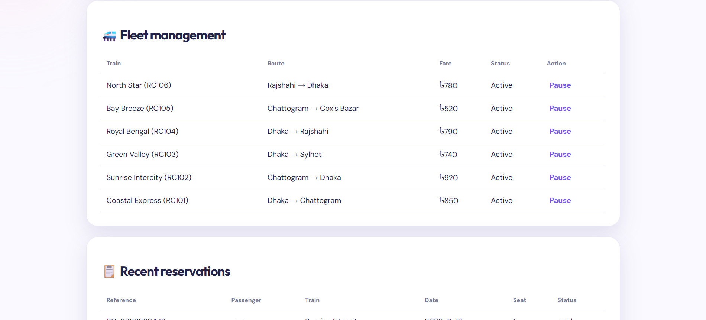

### Reservation management

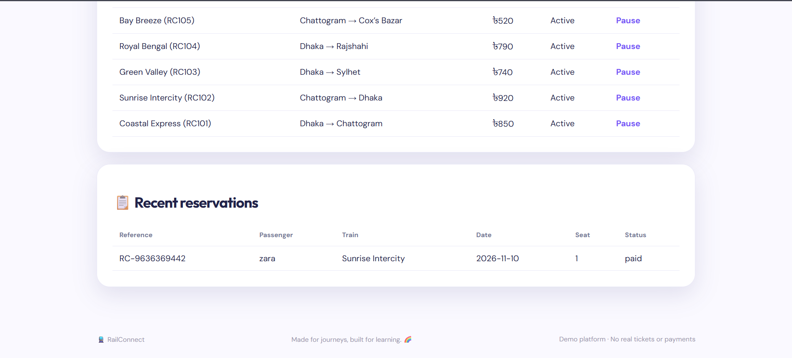

## CV / LinkedIn description
**RailConnect — Railway Ticket Booking & Reservation System** | Python, Flask, SQLite, JavaScript, ReportLab. Developed a responsive booking demo with route search, transactional seat reservations, simulated checkout, downloadable QR-coded PDF tickets, role-based administration, and automated tests.

MIT License. See `LICENSE`.
